# Model Data dan Aturan Kepemilikan

## Gambar pendamping pelajaran pada migration 13

`013_add_lesson_images` menambahkan `st_lesson_images`; skema menjadi versi 13 dengan 33 tabel. Unique `lesson_id` membatasi satu gambar pendamping per pelajaran, bukan daftar lampiran. FK ke `st_lessons` dan `st_users` (`uploader_user_id`) memakai RESTRICT; unique `storage_key` mencegah dua metadata memakai kunci berkas yang sama. Downgrade menolak saat metadata masih ada atau pemeriksaan tabel gagal. Berkas di filesystem tidak otomatis tercakup oleh rollback migration.

Metadata meliputi kunci acak internal, MIME PNG/JPEG, ukuran byte, lebar/tinggi, SHA-256, `alt_text` wajib 3–300 karakter, `caption` opsional maksimal 1.000 karakter, `source_note` wajib 5–2.000 karakter, status hak `owned/licensed/public_domain`, pengunggah, dan timestamp UTC. Field teks divalidasi UTF-8, dibatasi, dan dirender sebagai teks biasa. Nama berkas asli/path pengguna tidak menjadi nama penyimpanan; `storage_key`, hash, dan ID pengunggah tidak dirender oleh view. Sumber dan hak penggunaan gambar terpisah dari hak teks pelajaran, serta memang terlihat kepada peserta yang mempunyai akses materi.

`uploader_user_id` adalah atribusi, bukan izin mengelola. `Lesson_media_model::change` mengunci kursus, pelajaran, akun aktor dan metadata terkait, lalu memeriksa kembali akun/peran, pemilik kursus/admin sistem, status draf, hubungan pelajaran-kursus, serta revisi pelajaran. Upload, perubahan keterangan, dan pelepasan yang benar-benar mengubah data menaikkan versi pelajaran **dan** kursus bersama audit `content.lesson_image_changed`. Metadata audit hanya memuat tindakan, ID dan versi, bukan gambar, sumber, path atau isi keterangan. No-op tidak menaikkan versi/audit; form usang ditolak, bukan ditimpa. Materi teks, progres peserta, wallet dan jawaban tidak ditulis oleh operasi ini.

Pengajuan dan persetujuan kursus memeriksa kelengkapan metadata serta keberadaan/keutuhan berkas melalui `ready_for_review`; gambar rusak atau hilang menahan publikasi. Kursus tanpa gambar tetap dapat ditinjau sebagai materi teks. Editor gambar hanya untuk pemilik/admin pada draf. Pratinjau pengelola mengikuti lingkup kursus; endpoint peserta memerlukan kursus/pelajaran terbit dan `can_access_lesson`, termasuk pembedaan gratis, pratinjau, enrollment dan akses dicabut. Tidak ada URL unduh langsung yang melewati pemeriksaan ini.

`get_for_lesson` membedakan baris, `NULL` (tidak ada gambar), dan `FALSE` (pembacaan gagal). `get_for_course` mengembalikan peta berdasarkan ID pelajaran atau `FALSE`; controller tidak mengubah kegagalan menjadi daftar kosong. GET/HEAD gambar memeriksa hash/ukuran/jenis berkas dan mengirim respons private/no-store/noindex, `nosniff`, serta kebijakan same-origin. HEAD mempunyai metadata respons tanpa body. Detail penyimpanan privat dan batas berkas ada di [panduan lingkungan](PANDUAN_LINGKUNGAN_DAN_DEPLOYMENT.md#gambar-pendamping-pelajaran-lingkungan-dan-batas-bukti).

Filesystem dan database bukan satu transaksi atomik. Normalisasi menghasilkan berkas baru sebelum transaksi metadata; kegagalan yang terkonfirmasi dapat membersihkan berkas baru, sedangkan commit sukses memperbolehkan pembersihan berkas lama. Hasil commit/rollback yang belum pasti mengembalikan `uncertain` dan tidak menghapus berkas yang mungkin masih dirujuk. Kegagalan cleanup dicatat untuk rekonsiliasi, bukan disembunyikan sebagai keberhasilan pembersihan. Restore database saja tidak memulihkan gambar. [Latihan pemulihan berpasangan terisolasi](PANDUAN_PEMULIHAN_MEDIA.md) lulus pada 15 Oktober 2026; pemulihan operasional dan pembersihan orphan otomatis belum diselesaikan.

Bukti lokal mencakup normalisasi CLI PHP 8.1, fault injection transaksi pada fixture, dan HTTP Apache 8.0 untuk akses, metadata/revisi, pembacaan biner, pelepasan, serta gerbang review/publikasi. Apache tersebut tidak mempunyai GD sehingga unggahan HTTP valid ditolak 503; ini bukan bukti unggah sukses. Enam kombinasi browser editor/pratinjau telah diperiksa. Latihan restore CLI terpisah membandingkan isi dan struktur 33 tabel serta byte tiga gambar, memeriksa hak model, dan menolak berkas hilang/rusak/tertukar/tambahan. Fixture mengisi 11 tabel, sedangkan 22 tabel lainnya kosong; hasil ini bukan bukti pemulihan seluruh jenis data aplikasi. Unggah multipart sukses HTTP PHP 8.1, race paralel media, filesystem penuh, putus koneksi sesudah COMMIT, restore operasional/HTTP setelah restore, dan Ubuntu/PHP-FPM tetap memerlukan bukti tersendiri.

## Susunan bagian dan pelajaran draf

`Course_structure_model` memakai `st_course_sections` dan `st_lessons` yang sudah ada; tidak menambah tabel. `Course_structure::index` membatasi GET/HEAD/POST pada admin sistem atau editor pemilik kursus draf. Model memeriksa ulang akun/peran aktif dan kepemilikan setelah mengunci kursus dan akun aktor, lalu memvalidasi ID bagian/pelajaran dalam kursus yang sama. Hak `can_manage_all` tidak dipercaya dari input pemanggil.

Tambah/ubah bagian dan pemindahan pelajaran membawa `content_version` kursus. Sukses menaikkan versi kursus, mencatat `content.structure_changed` dan commit bersama; pemindahan juga menaikkan versi pelajaran. Revisi usang ditolak 409; no-op tidak menulis versi/audit. Kegagalan audit yang dipicu dalam pengujian membatalkan perubahan judul/urutan, versi dan timestamp. Isi materi, slug, progres, akses, jawaban dan snapshot tidak ditulis oleh operasi ini. Status review/terbit/arsip tidak menerima penyusunan ulang.

Urutan bersama adalah `section.sort_order, section.id, lesson.sort_order, lesson.id`; katalog dan indeks navigasi pelajaran menggunakan tie-break yang sama sehingga bagian bernomor sama tidak saling tercampur. Editor memiliki batas teknis 100 bagian, nomor urut 1–9999, dan query pelajaran sepuluh per halaman. Bagian kosong boleh disiapkan; penghapusan dan drag-and-drop tidak tersedia. Pengujian lokal belum membuktikan race paralel, PHP-FPM/MySQL target, atau UAT.

Pembuatan dan pengeditan pelajaran melalui `Content_model` menaikkan `st_courses.content_version` bersama perubahan materi/audit. `update_lesson_draft` menerima revisi pelajaran yang dilihat pengguna; perbandingan dilakukan setelah lock kursus/pelajaran, sebelum menulis. Form materi lama ditolak setelah editor lain menyimpan atau posisi pelajaran berubah. Penambahan pelajaran membuat form susunan lama usang. Audit mencatat versi lama/baru, bukan isi materi. Tidak ada migration baru untuk pengamanan versi ini.

Pada model susunan, hasil rollback dan commit diperiksa, dan mode debug DB dipulihkan dalam `finally`. Gagal atau exception rollback/commit menghasilkan `uncertain`, bukan klaim data pasti batal. Lima belas probe kegagalan transaksi membuktikan baris/versi/timestamp/audit tidak berubah; dua probe tambahan sengaja menggagalkan rollback model, lalu harness membersihkan transaksi sintetis secara eksplisit. Ini bukan simulasi koneksi terputus setelah server melakukan commit.

## Kredensial dan pencabutan sesi

Tidak ada perubahan skema untuk ganti sandi sendiri. `st_users.password_hash` tetap satu-satunya hash sandi; sesi hanya membawa HMAC `credential|id|password_hash` dengan kunci aplikasi. `find_active_user` membuang hash mentah sebelum mengembalikan data pengguna. HMAC diperiksa oleh `MY_Controller` pada setiap request akun; hash atau kunci berubah, penanda hilang, atau akun tidak aktif menghapus autentikasi/konteks pencarian privat dan merotasi ID sesi. Request yang sudah berjalan tetap perlu pemeriksaan transaksi untuk aksi sensitif.

`Account_model::change_password` memakai lock baris akun dan pemeriksaan ulang HMAC, sandi lama, peran/minimum serta limit gagal. Perubahan hash dan `auth.password_changed` berada dalam satu transaksi; metadata audit hanya `sessions_revoked`, tanpa sandi/hash/HMAC. `st_login_failures` memakai namespace HMAC terpisah `password-change`/`password-change-address`, bukan identitas login biasa. Limit 10 kegagalan per akun selama 15 menit mengikuti lintas perangkat; keberhasilan tidak menghapus histori gagal. Tidak ada penggantian akun tujuan lewat body, perubahan tautan keluarga, dompet atau progres.

## Proyeksi baca panel audit

`Audit_log_model` membaca hanya `id`, `actor_user_id`, `event_type`, `entity_type`, `entity_id`, dan `created_at` dari `st_audit_events`, tanpa join akun/hasil belajar, `details_json` atau `correlation_id`. Filter terikat parameter melalui query builder; urutan menggunakan allowlist waktu/ID dan 20 hasil per halaman. Rentang tanggal WIB diterjemahkan ke UTC dengan awal inklusif dan hari sesudah tanggal akhir eksklusif. Kode tidak dikenal mendapat label generik. Permintaan baca tidak menambah audit baru dan tidak mengubah data. Tidak diperlukan perubahan skema untuk panel ini; korelasi, retensi dan audit perubahan lengkap belum diselesaikan.

**Status:** peta skema prototipe saat migration 13; bukan persetujuan akhir model bisnis
**Pembaruan:** migration `013` menambahkan satu gambar pendamping per pelajaran; jumlah tabel menjadi 33. Fondasi histori Cocokkan Pasangan dari migration `012` tetap dipertahankan.
**Basis bukti:** migration CI3 `001`–`013` dan skema `db_study` lokal  
**Catatan:** kolom tidak berlabel `FK` pada diagram bukan foreign key formal di database. Migration tetap menjadi sumber kebenaran skema.

Dokumen ini mencatat relasi yang benar-benar ada agar pengembangan fitur, tes IDOR, dan review migration menggunakan istilah konsisten. Struktur pembayaran/dompet pada skema adalah kerangka awal, bukan bukti bahwa alur top up atau pembelian sudah dapat digunakan.

## Direktori pengguna internal tanpa perubahan skema

`User_directory_model` membaca ID/username/jenis/status/tanggal dibuat dari `st_users`, lalu peran bagi maksimal 20 hasil dari `st_user_roles` dan `st_roles`. Filter peran memakai EXISTS agar akun multi-role tidak terhitung ganda. Email, nama tampilan, password dan data belajar tidak masuk proyeksi hasil direktori. Ini tidak mengubah pemuatan identitas akun yang sedang masuk untuk header aplikasi.

Controller mensyaratkan admin sistem aktif pada setiap request; konteks pencarian tidak menjadi izin. POST ber-CSRF menyimpan kata pencarian di sesi, terikat ID admin dan token acak 128-bit, maksimal sepuluh konteks terbaru. Tidak ada tabel pencarian baru atau penulisan akun/peran/audit saat membaca. GET hanya membawa token konteks, filter allowlist dan halaman; token tidak dikenal atau dari sesi lain menghasilkan 400, bukan daftar tanpa filter. Logout/berakhirnya sesi atau eviction membatalkan konteks. Tidak ada ekspor, impersonasi, atau akses hasil/soal anak.

## ERD ringkas

```mermaid
erDiagram
    ST_USERS ||--o{ ST_FAMILY_LINKS : parent
    ST_USERS ||--o{ ST_FAMILY_LINKS : child
    ST_USERS ||--o{ ST_USER_ROLES : has
    ST_ROLES ||--o{ ST_USER_ROLES : grants
    ST_USERS ||--o{ ST_USER_ROLES : granted_by
    ST_USERS ||--o{ ST_ACCOUNT_TOKENS : owns
    ST_USERS ||--o{ ST_COURSES : authors
    ST_USERS ||--o{ ST_COURSES : updates
    ST_CATEGORIES o|--o{ ST_COURSES : classifies
    ST_COURSES ||--o{ ST_COURSE_SECTIONS : contains
    ST_COURSE_SECTIONS ||--o{ ST_LESSONS : contains
    ST_LESSONS ||--o| ST_LESSON_IMAGES : supplementary_image
    ST_USERS ||--o{ ST_LESSON_IMAGES : uploads
    ST_LESSONS ||--o| ST_FLASHCARD_DECKS : activity
    ST_USERS ||--o{ ST_FLASHCARD_DECKS : authors
    ST_FLASHCARD_DECKS ||--o{ ST_FLASHCARDS : contains
    ST_USERS ||--o{ ST_FLASHCARD_PROGRESS : learner
    ST_FLASHCARDS ||--o{ ST_FLASHCARD_PROGRESS : progress
    ST_USERS ||--o{ ST_MATCHING_RUNS : learner
    ST_LESSONS ||--o{ ST_MATCHING_RUNS : activity
    ST_MATCHING_RUNS ||--o{ ST_MATCHING_MOVES : choices
    ST_USERS ||--o{ ST_CONTENT_REVIEWS : reviews
    ST_COURSES ||--o{ ST_CONTENT_REVIEWS : review_history
    ST_COURSES o|--o{ ST_QUESTIONS : source
    ST_USERS o|--o{ ST_QUESTIONS : authors
    ST_USERS o|--o{ ST_QUESTIONS : child_target
    ST_QUESTIONS ||--o{ ST_QUESTION_OPTIONS : offers
    ST_PACKAGES ||--o{ ST_PACKAGE_COURSES : includes
    ST_COURSES ||--o{ ST_PACKAGE_COURSES : included_in
    ST_USERS ||--o| ST_WALLETS : owns
    ST_WALLETS ||--o{ ST_WALLET_ENTRIES : ledger
    ST_USERS o|--o{ ST_WALLET_ENTRIES : actor
    ST_USERS ||--o{ ST_PAYMENT_ORDERS : places
    ST_WALLETS ||--o{ ST_PAYMENT_ORDERS : credits
    ST_USERS ||--o{ ST_ENTITLEMENTS : receives
    ST_PACKAGES ||--o{ ST_ENTITLEMENTS : grants
    ST_PAYMENT_ORDERS o|--o{ ST_ENTITLEMENTS : source_order
    ST_USERS ||--o{ ST_COURSE_ENROLLMENTS : learner
    ST_COURSES ||--o{ ST_COURSE_ENROLLMENTS : enrollment
    ST_ENTITLEMENTS o|--o{ ST_COURSE_ENROLLMENTS : authorizes
    ST_PACKAGES o|--o{ ST_COURSE_ENROLLMENTS : source_package
    ST_USERS ||--o{ ST_LESSON_PROGRESS : learner
    ST_LESSONS ||--o{ ST_LESSON_PROGRESS : progress
    ST_USERS ||--o{ ST_PRACTICE_SESSIONS : creator
    ST_USERS ||--o{ ST_PRACTICE_SESSIONS : learner
    ST_COURSES o|--o{ ST_PRACTICE_SESSIONS : practice_source
    ST_PRACTICE_SESSIONS ||--o{ ST_SESSION_QUESTIONS : selects
    ST_QUESTIONS ||--o{ ST_SESSION_QUESTIONS : selected
    ST_PRACTICE_SESSIONS ||--o{ ST_PRACTICE_ATTEMPTS : attempts
    ST_USERS ||--o{ ST_PRACTICE_ATTEMPTS : learner
    ST_PRACTICE_ATTEMPTS ||--o{ ST_PRACTICE_ANSWERS : answers
    ST_QUESTIONS ||--o{ ST_PRACTICE_ANSWERS : answered
    ST_QUESTION_OPTIONS o|--o{ ST_PRACTICE_ANSWERS : selected
    ST_USERS o|--o{ ST_AUDIT_EVENTS : actor
```

`study_migrations` mencatat versi migration; tabel tersebut bukan bagian dari data pengguna. `st_login_failures` menyimpan digest identitas/alamat untuk pembatasan login dan tidak memiliki relasi FK ke akun. Tabel transaksi dan wallet tidak memiliki tabel webhook Midtrans pada skema saat ini.

## Aturan kepemilikan yang harus dipertahankan

| Data | Pemilik/lingkup | Pemeriksaan wajib pada server |
| --- | --- | --- |
| Akun anak | Anak, dengan hubungan keluarga aktif ke orang tua | Setiap pembacaan/perubahan dari orang tua harus mencocokkan `parent_user_id`, `child_user_id`, dan status tautan aktif; ID saja tidak cukup. |
| Progres pelajaran | Peserta (`learner_user_id`) | Peserta hanya mengubah progres sendiri; orang tua hanya melihat ringkasan anak yang tertaut aktif. Jangan izinkan perubahan progres lewat ID peserta yang dikirim browser. |
| Isi set dan kartu flashcard | Pengelola konten pada pelajaran dalam draf kursus; isi mewarisi sumber/hak pelajaran | Edit hanya saat kursus draf, tampilkan seluruh sisi depan/belakang pada review dua peran, lalu kunci edit setelah terbit sampai alur revisi tersedia. Tidak mengimpor konten Pustaka secara otomatis. |
| Progres flashcard | Peserta (`learner_user_id`) per kartu | Simpan status `learning`/`known` hanya untuk akun aktif sendiri; verifikasi kartu masih berada di pelajaran terbit yang dapat diakses. Status sama bersifat idempoten. Tidak dihitung sebagai XP atau kredit. |
| Latihan mandiri kursus | Peserta yang memulai (`learner_user_id`); pembuat sesi adalah peserta yang sama | Query attempt dan riwayat membatasi pemilik pada sesi sekaligus attempt. Soal hanya dari kursus terbit yang dapat diakses; cek ulang akses saat lanjut/simpan/final. Hasil selesai tetap dapat dibaca pemilik setelah kursus diarsipkan, tetapi bukan dibuka oleh admin/orang tua melalui ID. |
| Laporan latihan anak | Orang tua dengan tautan keluarga aktif, hanya baca | Route keluarga khusus memeriksa akun parent/child aktif dan join kepemilikan sesi sekaligus attempt pada setiap query. Detail hanya untuk status `graded`; parent tidak mendapat akses route pengerjaan anak. Tidak ada bypass admin. |
| Sesi khusus keluarga | Pembuat (`created_by_user_id`) dan satu anak tujuan (`learner_user_id`) | Editor/pengiriman hanya untuk pembuat tertaut; anak tujuan mengerjakan setelah kirim sesuai jadwal/hak. Hasil privat hanya pembuat tertaut serta peserta sendiri. Orang tua kedua/admin tidak mendapat bypass. Hasil selesai tetap dibaca anak setelah tautan/hak berubah. |
| Soal keluarga | Pembuat dan anak sasaran jika `family_private` | Cek kepemilikan pembuat serta anak yang dituju. Jangan mengirim `is_correct` ke browser sebelum jawaban final diterima. |
| Kursus dan materi | Penulis/pengelola konten untuk draf; publik hanya untuk terbit | Saring status dan izin pada query/model; validasi lagi saat edit, review, terbit, arsip, dan baca. |
| Gambar pendamping pelajaran | Mengikuti kursus/pelajaran; pengunggah bukan pemilik izin tersendiri | Mutasi hanya draf milik editor/admin dengan revisi; pratinjau dan GET/HEAD peserta memeriksa lingkup/status/akses sebelum membaca berkas privat. Sumber/hak gambar wajib tersendiri, tanpa URL filesystem publik. |
| Enrollment dan entitlement | Peserta yang ditetapkan dan paket/order sumber | Verifikasi status enrollment, pemilik entitlement, masa aktif, dan kursus yang tercakup. Jangan menyamakan enrollment manual, gratis, dan paket. |
| Wallet, entri, order | Pemilik wallet/pembayar | Perubahan ledger harus transaksional, append-only, idempoten, dan merujuk transaksi sah. Anak tidak boleh menggunakan saldo orang tua tanpa alur otorisasi yang disepakati. |
| Audit | Operasi dan aktor sistem | Catat tindakan sensitif tanpa password, token, secret, atau teks jawaban privat yang tidak diperlukan. Batasi akses baca audit. |

## Batas model saat ini

### Daftar lanjut belajar dari dashboard

`Content_model::get_resumable_lessons()` membaca `st_lesson_progress` milik ID pengguna dari sesi, bukan parameter query browser. Hanya `in_progress` pada pelajaran dan kursus terbit yang dipilih. Filter gratis/pratinjau atau enrollment aktif dan entitlement paket yang berlaku mengikuti pemeriksaan halaman materi, diterapkan sebelum `LIMIT 3`; `EXISTS` mencegah duplikasi kartu. Urutan `updated_at DESC, lesson_id DESC` stabil ketika waktu sama. Pembacaan ini tidak membuat enrollment, memperbarui posisi, atau menghapus progres yang aksesnya berubah.

Hasil hanya membawa identitas/judul tujuan, posisi tersimpan, dan waktu penyimpanan; kegagalan query dibedakan dari hasil kosong. Controller tidak memanggil daftar ini untuk akun orang tua. Ringkasan keluarga dan ringkasan progres kursus tetap terpisah: ringkasan historis bukan bukti bahwa setiap materi masih dapat dibuka. Tidak ada migration atau tabel baru untuk daftar ini, dan pemeriksaan akses tujuan tetap wajib pada setiap permintaan.

### Latihan mandiri kursus pada migration 9

Soal `shared` tanpa `target_child_user_id` disusun dalam kursus draf oleh penulis/admin. Maksimal 50 soal dengan empat pilihan unik dan satu kunci; pembahasan, sumber, serta status hak wajib. Pengajuan dan keputusan review mengubah status soal bersama kursus. Semua perubahan soal menaikkan versi kursus dan dicatat tanpa teks soal/jawaban dalam event audit. Kursus terbit tidak mempunyai editor soal aktif.

Setiap percobaan latihan mandiri memiliki satu `st_practice_sessions` bertipe `course_quiz` dan satu `st_practice_attempts`. Kolom `course_id` memiliki FK ke kursus; pasangan `(learner_user_id, idempotency_key)` unik untuk mengenali pengiriman ulang tombol mulai. Kunci itu berasal dari token acak bertanda HMAC yang terikat pengguna dan kursus. Penguncian baris kursus menyatukan pemeriksaan percobaan aktif dan pembuatan sesi sehingga dua mulai pada kursus/peserta yang sama tidak membuat dua percobaan aktif melalui model ini. Aturan `equal_weight_v1` disimpan pada sesi dan tetap digunakan untuk histori tersebut.

`st_session_questions.snapshot_json` menyimpan prompt, pembahasan, versi, pilihan, dan kunci saat mulai; `sort_order` menyimpan urutan aktual. Grading memakai snapshot, bukan soal yang mungkin kemudian berubah. Snapshot ini bersifat internal dan tidak dikirim mentah ke view. Model hanya mengembalikan prompt/pilihan/jawaban tersimpan ketika attempt aktif; penanda benar dan pembahasan baru disertakan setelah status `graded`.

`st_practice_attempts.answer_revision` bertambah saat simpan/final. Klien harus mengirim revisi yang terakhir dibacanya; versi usang menghasilkan 409 tanpa menimpa data. Simpan sementara mencatat pilihan dengan `is_correct=NULL`. Finalisasi mengunci kursus lalu attempt, memeriksa akses dan revisi, menyimpan pilihan termasuk jawaban kosong, menghitung nilai menggunakan bilangan bulat untuk pembulatan dua desimal, dan menutup sesi dalam satu transaksi. Pengiriman ulang pada attempt selesai hanya mengarah ke hasil yang sudah ada. Waktu mulai/final dan jumlah benar/soal tersimpan; audit hanya mencatat identitas attempt serta aktor.

Downgrade migration 9 menolak bila sesi berkaitan kursus sudah ada, karena menghapus kolom snapshot/idempotensi akan merusak histori. Jangan memaksa rollback skema setelah data latihan nyata masuk; gunakan perbaikan maju dan backup yang diuji. Pemulihan jawaban saat ini melalui tombol simpan sementara dan riwayat, bukan autosave/offline. Uji beban request serentak, retensi/hapus histori, analisis per topik, dan skenario sesi keluarga masih pekerjaan lanjutan.

Laporan keluarga memakai `Family_practice_model`, tanpa migration baru. Ringkasan menghitung semua percobaan anak tersebut (termasuk pengulangan), bukan jumlah kursus yang dikuasai atau rata-rata nilai gabungan. Riwayat memakai SQL LIMIT/OFFSET 10 dengan urutan ID terbaru. Ringkasan, riwayat, dan detail masing-masing mengulang join tautan aktif, akun parent/child aktif, serta pemilik sesi/attempt yang sama. Pembahasan berasal dari snapshot selesai; riwayat tetap tersedia setelah kursus diarsipkan. Controller hanya mengizinkan GET/HEAD, mengirim `private, no-store`, dan menolak detail attempt aktif. Hak keluarga tidak memberi hak mengerjakan atas nama anak. Pencabutan berlaku pada permintaan berikutnya, bukan menghapus informasi yang sudah dibaca/disimpan pengguna.

- Skema mempunyai tabel wallet, ledger, order, package, entitlement, sesi, pertanyaan, jawaban, dan progres, tetapi tabel tersedia tidak berarti workflow/controller aman dan lengkap sudah tersedia.
- Dompet unik per `owner_user_id`; pilihan pembayar keluarga, pembagian kredit, dan apakah entitlement langsung dimiliki anak atau orang tua perlu ditetapkan sebelum checkout dibuat.
- Relasi keluarga saat ini memodelkan orang tua dan anak, belum persetujuan multi-orang-tua, undangan sekali pakai, atau pencabutan dengan kebijakan retensi yang final.
- `st_course_enrollments` dan `st_entitlements` adalah dua lapis berbeda. Kebijakan untuk enrollment gratis/manual dan entitlement paket harus tetap terpisah serta diuji positif dan negatif.
- Migration 7 menambah `st_flashcard_decks`, `st_flashcards`, dan `st_flashcard_progress`. Deck melekat satu-ke-satu pada pelajaran; publikasi mengikuti status kursus/pelajaran, dan progres per pengguna tidak mengubah konten. Admin hanya mengubah deck saat kursus draf dan tiap perubahan menaikkan versi kursus serta dicatat pada audit.
- Migration 8 menambah `st_courses.prerequisites` sebagai teks opsional untuk informasi persiapan belajar. Field ini ditampilkan dengan escaping di halaman pengelola dan katalog/detail publik; isinya tidak menjadi syarat akses atau prerequisite yang ditegakkan sistem. Boleh kosong, panjang maksimum 2.000 karakter, dan perubahan konten draf tetap menaikkan versi serta tercatat di audit.
- Latihan mandiri memakai default sementara yang telah diimplementasikan dan diuji; pengacakan, ujian resmi, sesi khusus keluarga, retensi histori, dan rilis produksi masih memerlukan rancangan serta validasi lanjutan. Keberadaan skema saja tidak menutup pekerjaan tersebut.
- FK membantu konsistensi referensi, tetapi tidak menggantikan otorisasi aplikasi. Banyak kolom kepemilikan membutuhkan pemeriksaan silang lintas tabel pada setiap query.

## Perubahan yang memerlukan migration

### Migration 10: kapabilitas paket dan draf keluarga

`st_packages.family_practice_enabled` default 0 (ditolak secara bawaan). `Parent_practice_model::has_access` memeriksa entitlement akun orang tua, status aktif, waktu mulai dan berakhir dalam UTC, serta kapabilitas paket. Tidak ada pemberian akses dari query string, jenis akun saja, saldo, atau status pembayaran di browser. Arsip paket bukan pencabutan entitlement yang telah dimiliki; pencabutan eksplisit melalui entitlement/capability.

`st_practice_sessions.draft_revision` default 0 bertambah setiap perubahan draf. Sesi `parent_assigned` memakai `course_id=NULL`, pembuat/anak tetap, `rules_version=equal_weight_v1`, dan key idempotensi pembuatan. Soal berstatus draf dengan `visibility=family_private`, pembuat serta target anak yang cocok, `course_id=NULL`, dan satu relasi `st_session_questions`. Selama draf, relasi belum memiliki snapshot; pengiriman menambahkan snapshot beku. Edit/hapus menolak soal yang dipakai beberapa sesi, sesi dengan attempt, serta nomor revisi usang. Soal tidak masuk katalog/bank kursus.

Pembuatan mengunci akun orang tua sebelum memeriksa tautan, entitlement, token replay, dan batas 100 draf; perubahan mengunci pemilik/sesi dan memeriksa ulang izin. Batas 50 soal, empat opsi berbeda, satu kunci dan metadata wajib menggunakan validator yang sama dengan soal kursus. Pembatalan hanya mengubah status menjadi `cancelled` dan menyimpan isi, bukan menghapus riwayat. Audit menyimpan jenis aksi/ID aktor/sesi, tidak soal atau jawaban privat. Downgrade ditolak bila ada sesi parent-assigned atau paket yang mengaktifkan fitur; perbaikan maju lebih aman daripada membuang riwayat.

Fase draf dilanjutkan dengan pengiriman/pengerjaan di migration 11 di bawah. Laporan keluarga umum tetap khusus `course_quiz`; hasil `parent_assigned` privat dibuka melalui sesi milik pembuat, bukan laporan semua orang tua yang tertaut.

### Migration 11: kirim, jadwal, dan satu attempt

`st_practice_sessions.available_from` menyimpan awal jadwal UTC; `available_until` yang sudah ada wajib terisi saat kirim. `Practice_schedule` membaca input WIB, menolak tanggal tidak valid, akhir tidak setelah mulai, jadwal lewat, dan akhir lebih dari 90 hari. Mulai kosong berarti sekarang. Pengiriman divalidasi terhadap revisi, hubungan aktif, hak paket, dan 1–50 soal privat lengkap. Snapshot prompt/versi/opsi/kunci/pembahasan dibekukan dalam transaksi. Setelah kirim, isi/jadwal terkunci; preview pembuat dan penilaian membaca snapshot, bukan sumber yang mungkin berubah. Replay kirim tidak menggandakan audit.

`uq_st_attempt_session_learner(session_id, learner_user_id)` memastikan satu attempt per sesi/peserta pada MVP. Latihan kursus yang diulang memang membuat sesi baru; pengembangan ujian dengan beberapa attempt pada sesi sama perlu migration/rancangan tersendiri. `Assignment_model` selalu mencocokkan peserta tujuan, tipe sesi, akun parent/child aktif dan tautan pembuat; daftar anak tidak memuat draf. Mulai mengunci akun pembuat lalu sesi, memakai attempt yang ada atau membuat satu. Penilaian dan simpan memakai mesin `Practice_model` yang sama dengan kursus, dengan pemeriksaan akses khusus keluarga sebelum mengunci attempt. Mutasi kirim, mulai, simpan, final dan pembatalan memakai urutan penguncian pembuat → sesi → attempt untuk mencegah final dan pembatalan saling menimpa. Entitlement serta jadwal diperiksa server pada mulai/simpan/final.

Status alur: `draft → available → in_progress → completed`; pembuat dapat membatalkan `available/in_progress` menjadi `cancelled`, dengan attempt aktif menjadi `abandoned`. Pembatalan mempertahankan snapshot/jawaban tanpa menilai otomatis. Jadwal terlewati ditampilkan sebagai kedaluwarsa dan ditolak saat operasi walaupun status tersimpan masih `available/in_progress`; tidak ada job yang mengubah status lewat pembacaan GET. Finalisasi tidak dapat dibatalkan. Deadline atau hak habis menutup pengerjaan aktif, tidak menghapus data. Pemulihan hak sebelum deadline memungkinkan lanjut; anak tetap memiliki akses ke hasilnya sendiri yang sudah final. Pembuat harus tetap tertaut untuk membaca hasil, tetapi tidak perlu entitlement aktif untuk histori selesai. Orang tua lain yang tertaut ke anak sama tidak mendapat isi sesi privat tersebut.

Downgrade migration 11 ditolak jika jadwal kirim sudah digunakan. Backup/perbaikan maju lebih aman daripada menghilangkan jadwal dan constraint dari data nyata. Uji replay/stale-tab bersifat berurutan; load serentak, riwayat perubahan yang ditampilkan dalam UI, notifikasi, dan UAT tetap terbuka.

### Penyalinan sesi keluarga tanpa migration baru

`Parent_practice_copy_model` membuat sesi draf mandiri dalam satu transaksi, bukan menautkan ulang soal sumber. Penguncian akun pembuat → sesi sumber → tautan anak tujuan → entitlement selaras dengan operasi keluarga lain. Kedua anak (sumber/tujuan) harus tertaut aktif dan pembuat mempunyai kapabilitas aktif. Validasi seluruh soal dilakukan sebelum penulisan; source revision, batas 50 soal dan 100 draf tetap ditegakkan. Replay mengembalikan ID salinan yang sudah ada, tanpa menambah audit atau menggandakan soal.

Soal dan opsi mendapatkan ID baru, target anak tujuan dan versi 1; sesi berstatus draf/revisi 0, tanpa jadwal/snapshot/attempt/jawaban/nilai. Soal draf memakai isi terkini; sesi pernah dikirim memakai snapshot. Snapshot pengiriman baru turut menyimpan `source_note` dan `rights_status`. Snapshot lama tanpa dua field tersebut tetap memakai metadata soal privat yang terkunci setelah pengiriman; tidak ada perubahan massal JSON historis. Audit `family.practice_copied` menyimpan ID sumber, revisi sumber dan anak tujuan, tanpa teks soal atau jawaban. Struktur 30 tabel/migration 11 tidak berubah.

### Daftar sesi keluarga

Daftar sesi orang tua memakai scope pembuat + tautan aktif yang sama untuk hitungan dan hasil. Filter judul, anak dan status digabung dengan AND; judul memakai bound `LIKE` dengan escape eksplisit `!` agar `%/_/!` diperlakukan literal. Status tampilan dihitung dengan CASE dari status tersimpan/jadwal menggunakan satu timestamp UTC per respons, juga diteruskan ke helper label. Sesi selesai/batal tidak berubah menjadi expired hanya karena deadline lewat. Query berurutan ID terbaru dengan LIMIT/OFFSET 10; pembacaan/filter tidak menulis status atau audit. Filter tidak mengganti scope kepemilikan dan tidak memerlukan entitlement untuk membaca histori yang masih tertaut.

### Cocokkan Pasangan tanpa penyimpanan skor

`Games::matching` hanya menerima GET/HEAD, mencari pelajaran/kursus terbit dan memanggil `Content_model::can_access_lesson` sebelum mengambil kartu. Data game adalah proyeksi teks depan/belakang yang sudah boleh dibaca dari deck pelajaran; ID pengguna, progres dan metadata privat tidak dikirim. `Matching_cards` menyaring maksimal 100 kartu dengan panjang per sisi maksimal 160 karakter serta menolak seluruh pasangan yang sisinya ambigu setelah normalisasi spasi/huruf. Mode lokal ini tidak memakai tabel histori, endpoint skor, penulisan audit/progres, atau akses ledger. JavaScript hanya mengelola babak dalam memori halaman; tidak ada network/storage. Fondasi server pada migration 12 dijelaskan di bawah dan belum dipanggil UI ini. Jika kelak ada XP atau reward, aturan dan validasi server tetap wajib; state browser tidak boleh menjadi bukti pemberian reward.

### Migration 12: fondasi histori Cocokkan Pasangan

Peningkatan pengiriman formulir lewat `matching-save.js` tidak menambah endpoint, tabel, antrean offline, atau penyimpanan browser. Hanya hasil GET server yang memperbarui progres di layar. Formulir dikunci ketika POST berlangsung; timeout/respons hilang tidak disamakan dengan rollback. Pengguna diarahkan mengambil keadaan terbaru sebelum memilih lagi, sehingga commit yang responsnya hilang tetap terlihat tanpa mengulangi mutasi.

`st_matching_runs` menyimpan pemilik peserta, pelajaran, judul, versi aturan, snapshot pasangan dan babak, state server, revisi, waktu mulai/selesai, serta status `in_progress/completed/abandoned`. `active_key` unik membatasi satu run aktif per peserta/pelajaran; nilainya dikosongkan pada status terminal. Pasangan peserta + `start_key` unik melindungi retry mulai, termasuk setelah selesai. Key mulai berbeda saat sudah ada run aktif ditolak 409, bukan diakui sebagai retry; UI nantinya harus menawarkan lanjutkan run yang ada. FK ke pengguna/pelajaran memakai RESTRICT agar histori tidak terhapus tidak sengaja.

`st_matching_moves` menyimpan run, key permintaan, revisi yang diharapkan, indeks kiri/kanan, hasil dan waktu server. Unique run + key mencegah duplikasi. `Matching_run_model` mengunci pelajaran lalu run/pengguna dalam transaksi, memeriksa kepemilikan dan akses materi, menilai melalui `Matching_state`, lalu menyimpan state dan log bersama. Revisi usang, pasangan di luar babak/sudah selesai, struktur state tidak konsisten, dan versi aturan tak dikenal ditolak. Audit hanya mencatat mulai/selesai/batal tanpa isi kartu. Batas teknis 10.000 langkah tidak berkaitan dengan kredit.

Snapshot tidak berubah saat kartu sumber diubah. Durasi hasil dihitung dari jam server sejak mulai, termasuk waktu jeda; bukan pengukuran waktu belajar aktif. Penghentian setelah akses habis diperbolehkan tanpa menghapus histori. Pembacaan `find_owned` hanya memeriksa akun aktif dan pemilik; controller aktif nantinya wajib memeriksa kembali hak konten sebelum mengirim snapshot, sedangkan hasil selesai boleh tetap dibaca pemilik. Model bukan pengganti autentikasi/CSRF/rate limit di endpoint.

Migration turun menolak menghapus kedua tabel jika sudah ada histori. Uji `matching-storage-check.ps1` hanya memakai fixture sintetis lokal `db_study`, memeriksa ownership, snapshot, replay, revisi, pencabutan akses, hasil/durasi, constraint run aktif, dan pembatalan; fixture persis yang dibuat dibersihkan. Unit `test-matching-state.php` mencakup 2–100 pasangan, babak 4/6, hitungan benar/salah, state tidak konsisten dan batas langkah. Dengan `-BaseUrl` loopback, skrip juga menjalankan `matching-http-cases.ps1` untuk alur peserta. Opsi `-RunResilienceCheck` menguji konkurensi dan pemulihan transport lokal seperti dijelaskan di bawah. Retensi, pengujian staging/browser lanjutan dan UAT tetap terbuka.

### Endpoint permainan tersimpan dan riwayat peserta

Controller `Matching` mewajibkan akun aktif, header private/no-store/noindex, batas metode GET/HEAD/POST dan ID numerik ketat. `permainan/tersimpan/pelajaran/{slug}` memulai lewat POST bertoken HMAC yang terikat peserta/pelajaran. `permainan/tersimpan/{id}` membaca run milik peserta dan hanya mengirim kartu babak aktif jika akses materi masih berlaku; hasil terminal hanya menampilkan ringkasan. POST pilihan membawa revisi, indeks dua kartu dan token HMAC terikat peserta/run/revisi; key permintaan berasal dari hash token. CSRF global tetap wajib. Hasil sukses memakai redirect 303, bukan klaim berhasil dari state browser.

`permainan/tersimpan/{id}/berhenti` memerlukan konfirmasi dan revisi terkini. GET tidak mengubah data; POST setelah akses materi habis masih dapat menghentikan run milik sendiri. `permainan/riwayat` adalah daftar pribadi dengan pencarian literal memakai bound LIKE + escape `!`, status whitelist, urutan ID terbaru, hitungan dan hasil berscope pemilik sama, LIMIT 10 dan offset dibatasi jumlah halaman. Daftar tidak mengambil snapshot kartu atau log langkah. Tidak ada mutasi saat membaca/filter, akses lintas peserta, atau penulisan dompet.

### Laporan permainan keluarga

`Family_matching_model` menggabungkan run → akun anak aktif → tautan keluarga aktif → akun parent aktif pada setiap query ringkasan, hitungan, daftar dan detail. Pemeriksaan controller saja tidak dianggap cukup. `Family::matching` dan `matching_result` memakai gerbang parent serta validasi ID numerik, GET/HEAD saja, header private/no-store/noindex. Route `keluarga/anak/{id}/permainan` menyediakan hitungan seluruh histori, filter judul/status dan pagination 10; route tambah `/{run_id}` hanya menampilkan proyeksi hitungan state/snapshot, status dan waktu. Teks kartu, urutan pilihan, JSON, request key dan token tindakan anak tidak diteruskan ke view.

Run aktif dilabeli progres sementara; completed menampilkan rentang waktu termasuk jeda, abandoned tidak dianggap selesai. Histori boleh dibaca orang tua tertaut meski materi diarsipkan atau akses paket habis, karena tidak mengirim isi materi. Kedua orang tua yang memang tertaut aktif boleh melihat catatan game kursus yang sama; ini berbeda dari soal privat keluarga yang hanya dapat dilihat pembuatnya. Revokasi tautan atau akun anak tidak aktif menutup laporan, dan tidak menghapus histori. Endpoint peserta tetap mensyaratkan pemilik sehingga orang tua tidak bisa mengirim pilihan/hentikan atas nama anak.

`matching-family-cases.ps1` membandingkan ringkasan dengan query sumber dan detail selesai 8 pasangan/9 pilihan/1 belum cocok, memeriksa semua status, literal search, paging, kondisi kosong, alias/direct route, akun/peran/tautan, dan digest state/snapshot/revisi plus jumlah log/audit/ledger sebelum/sesudah seluruh pembacaan. Fixture keluarga dibuat dan dibersihkan oleh suite matching lokal; tidak mengubah pengguna nyata. Retensi tetap memerlukan keputusan terpisah.

### Verifikasi transaksi bersamaan dan response hilang

`matching-resilience-check.mjs` memakai dua worker HTTP PHP 8.1 dan sesi berbeda pada akun fixture sama. Barrier CLI hanya mengunci baris pelajaran sintetis dan selalu rollback; tidak mengubah hasil. Observasi dua waiter InnoDB membuktikan dua mutasi telah masuk bersamaan sebelum dilepas. Request dengan key sama wajib menunjuk run/langkah yang sama; key berbeda pada start/revisi sama hanya boleh menghasilkan satu pemenang dan satu konflik 409. Penyelesaian terakhir harus memiliki delapan log/pasangan dan satu audit selesai. Benturan hentikan/pilih menghasilkan satu mutasi saja sesuai pemenangnya.

Proxy dapat membuang request sebelum forward atau seluruh response setelah commit. Tes membandingkan revisi/log dari database dengan GET dan retry melalui sesi kedua: sebelum forward tidak ada penulisan; setelah commit data tetap ada dan retry tidak menambah langkah. Pemeriksaan ini tidak memberi XP/kredit dan tidak mengubah skema. Bukti terbatas pada Windows/MariaDB lokal; pengujian concurrency PHP-FPM/MySQL target, refresh browser di tengah kirim dan beban produksi tetap perlu staging. Lihat panduan lingkungan untuk pembatasan runner serta cleanup proses/sesi/fixture.

### Prosedur perubahan skema

1. Sebelum mengubah pemilik wallet, enrollment, atau sesi keluarga, tetapkan aturan tenant dan alur persetujuan di `KEPUTUSAN_MVP_DAN_ASUMSI.md`.
2. Tambahkan migration naik yang dapat dijalankan di MariaDB/MySQL target; tulis juga strategi rollback yang tidak membuang transaksi, progres, atau histori review.
3. Uji dari database kosong dan database versi sebelumnya. Pertahankan migration produksi yang telah diterapkan; jangan edit migration lama.
4. Sertakan constraint/index yang sesuai, tes ownership negatif, dan pemulihan backup. Catat pembaruan ERD setelah skema benar-benar berubah.

Pengaman rollback lokal terbaru tidak mengubah SQL `up()`, nomor migration, atau skema yang sudah terpasang. `down()` 001–008 kini memeriksa seluruh tabel terdampak sebelum menghapus tabel/kolom; adanya data, hasil COUNT tidak sah, atau kegagalan pembacaan menghentikan langkah. Metadata gambar 013 memakai pemeriksaan ketat yang sama. Empat seed role juga data yang dilindungi; jangan menghapusnya untuk memaksa downgrade lolos. Aturan ini bukan alasan mengubah riwayat SQL migration produksi. Bukti penolakan/preservasi dan batas per-langkah ada di [Panduan Keamanan Migration](PANDUAN_KEAMANAN_MIGRATION.md).
