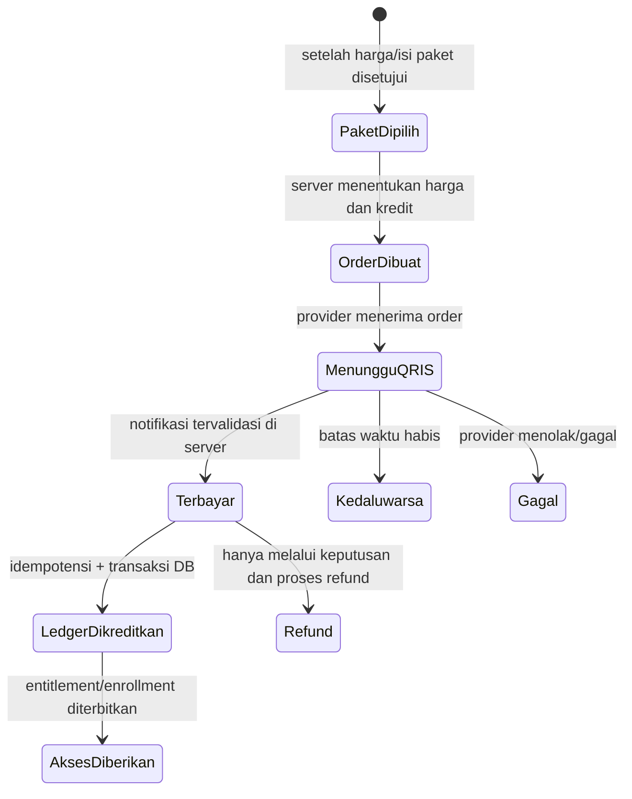

# Sitemap dan Alur Pengguna Study

## Keamanan akun sendiri

Dashboard → **Keamanan akun saya** → `akun/keamanan`. Semua jenis akun yang masuk mengisi sandi sekarang, sandi baru dan konfirmasi. Setelah berhasil kembali ke masuk; sesi perangkat lain ditolak saat request berikutnya. Tema mengikuti akun; anak mendapat petunjuk pendampingan. Halaman tidak menyediakan reset akun anak atau lupa sandi, dan tidak meminta ID pengguna tujuan.

## Panel jejak audit yang sudah tersedia

Admin sistem aktif → Panel pengelola → Jejak audit (`kelola/audit`). Halaman hanya baca dengan filter tanggal WIB, aksi/entitas, ID pelaku/entitas, urutan dan pagination. Editor, reviewer, keuangan, dukungan, orang tua dan peserta tidak mendapat akses. Tidak ada tautan untuk membuka soal/jawaban privat atau mengubah event; pencabutan peran/status admin berlaku pada permintaan berikutnya.

**Status:** peta kerja; bedakan route yang sudah aktif dari rancangan  
**Acuan implementasi:** `application/config/routes.php`, controller, dan checklist roadmap  
**Catatan:** item “direncanakan” belum berarti tersedia di aplikasi atau sudah disetujui untuk MVP.

## Sitemap saat ini

```mermaid
flowchart TD
    Home[Beranda publik /] --> Catalog[Katalog kursus /kursus]
    Home --> SignUp[Daftar /daftar]
    Home --> SignIn[Masuk /masuk]
    Catalog --> Course[Detail kursus /kursus/{slug}]
    Course --> Lesson[Materi /materi/{slug}]
    Lesson --> Save[POST simpan posisi /materi/{slug}/posisi]
    Lesson --> Complete[POST tandai selesai /materi/{slug}/selesai]
    Lesson --> MatchingLocal[Game lokal /permainan/pasangan/{slug}]
    MatchingLocal --> MatchingStart[Mode tersimpan /permainan/tersimpan/pelajaran/{slug}]
    MatchingStart --> MatchingRun[Main dan lanjut /permainan/tersimpan/{id}]
    MatchingRun --> MatchingStop[Konfirmasi berhenti /permainan/tersimpan/{id}/berhenti]
    MatchingRun --> MatchingHistory[Riwayat /permainan/riwayat]
    MatchingHistory --> MatchingRun
    SignIn --> Dashboard[Beranda belajar /beranda]
    Dashboard --> Security[Keamanan akun /akun/keamanan]
    Dashboard --> PracticeHistory[Riwayat latihan /latihan]
    Course --> CoursePractice[Mulai latihan kursus /latihan/kursus/id]
    CoursePractice --> Attempt[Pengerjaan dan hasil /latihan/percobaan/id]
    PracticeHistory --> Attempt
    Dashboard --> Assignments[Latihan dari orang tua /latihan/keluarga]
    Assignments --> Assigned[Detail penugasan /latihan/keluarga/id]
    Assigned --> Attempt
    Dashboard --> ParentSessions[Sesi privat /keluarga/latihan]
    ParentSessions --> ParentEditor[Susun dan kirim /keluarga/latihan/id]
    ParentEditor --> ParentCopy[Salin menjadi draf baru]
    ParentEditor --> ParentResult[Hasil privat pembuat]
    SignUp --> SignIn
    Dashboard --> Catalog
    Dashboard -->|Lanjutkan materi sendiri yang masih terbuka| Lesson
    Dashboard --> FamilyList[Daftar anak /keluarga/anak]
    Dashboard --> FamilyGames[Laporan permainan /keluarga/anak/{id}/permainan]
    FamilyGames --> FamilyGameDetail[Catatan game /keluarga/anak/{id}/permainan/{run_id}]
    FamilyList --> AddChild[Tambah anak /keluarga/anak/tambah]
    FamilyList --> ChangeStage[POST kelompok belajar /keluarga/anak/{id}/kelompok]
    Home --> Admin[Panel pengelola /kelola]
    Admin --> Courses[Daftar konten /kelola/kursus]
    Courses --> Draft[Tambah draf /kelola/kursus/tambah]
    Courses --> CourseAdmin[Detail draf /kelola/kursus/{id}]
    CourseAdmin --> LessonAdmin[Tambah/edit materi]
    CourseAdmin --> Review[Ajukan/review/arsip]
    Admin --> Categories[Kategori /kelola/kategori]
    Admin --> Users[Direktori pengguna /kelola/pengguna - admin sistem saja]
    Admin --> Audit[Jejak audit /kelola/audit - admin sistem saja]
    CourseAdmin --> Questions[Soal pilihan ganda kursus]
    FamilyList --> FamilyPractice[Laporan latihan kursus anak]
    FamilyPractice --> FamilyPracticeResult[Hasil final anak - hanya baca]
```

Daftar di atas menggambarkan route yang ada; izin tetap diperiksa di server. Menu tidak menjadi bukti bahwa route dapat diakses. Endpoint pengelola, keluarga, dan progres memerlukan autentikasi/peran sesuai controller.

Peserta dewasa/anak yang sudah menyimpan posisi dapat membuka **Beranda → Lanjutkan belajar → Lanjutkan materi**. Beranda memilih maksimal tiga pelajaran sendiri yang masih berjalan, terbit, dan dapat diakses, diurutkan dari progres terakhir disimpan. Tujuan memakai halaman materi yang sama dengan katalog dan memeriksa ulang akses sebelum memulihkan posisi baca. Jika akses dicabut setelah beranda terbuka, tautan lama tidak melewati pemeriksaan tersebut. Beranda tidak menulis progres; daftar kosong mengarah ke katalog, sedangkan daftar gagal dimuat menawarkan muat ulang. Orang tua tidak mendapat tautan lanjut atas nama anak.

## Aktor dan tugas utama

| Aktor | Tujuan | Jalur yang tersedia | Batas yang belum tersedia |
| --- | --- | --- | --- |
| Pengunjung | Mengenal layanan dan menemukan materi | Beranda → katalog → detail kursus → materi gratis/pratinjau | Tidak dapat menyimpan progres tanpa masuk; pembelian belum ada. |
| Peserta dewasa | Belajar sendiri dan melihat progres | Daftar/masuk → beranda belajar → materi/progres/flashcard → latihan mandiri atau game → riwayat masing-masing | Histori aktivitas terpadu, pembayaran, dan pemulihan akun belum tersedia. |
| Orang tua | Membuat akun anak dan memantau ringkasan | Masuk → tambah/ubah kelompok anak → ringkasan/laporan latihan dan game; hak penyusun aktif → sesi privat, kirim/jadwal/salin dan hasil | Tautan undangan, pembelian keluarga dan memilih soal bank lintas kursus belum tersedia. |
| Anak | Belajar pada tema kelompoknya | Masuk dengan akun yang dibuat orang tua → materi/flashcard, latihan kursus, penugasan privat orang tua atau game → hasil/riwayat sendiri | Anak tidak membayar; evaluasi kecocokan bahasa dan tampilan per usia belum selesai. |
| Pengelola konten | Menulis dan meninjau materi | Masuk → kelola kursus/kategori/soal kursus → draf → review terpisah → terbit; arsip oleh admin sistem | Pengelolaan media, bank soal lintas kursus, paket lengkap, dan panel operasional belum tersedia. |
| Admin sistem | Menjalankan operasi sesuai izin | Panel → direktori pengguna atau jejak audit hanya-baca, dengan filter, urutan dan pagination | Perubahan status/peran, ekspor, rekonsiliasi, refund dan dashboard kesehatan operasional belum dibangun. |
| Keuangan/dukungan | Operasi terbatas sesuai peran | Fondasi role dan panel terbatas; tidak dapat membuka direktori pengguna atau jejak audit admin | Rekonsiliasi, refund dan dukungan data anak belum dibangun; adanya panel audit admin tidak memberi izin kepada dua role ini. |

## Alur yang sudah diuji

### Peserta belajar materi

1. Pengunjung membuka katalog dan detail kursus. Materi pada kursus gratis atau pelajaran terbit yang ditandai pratinjau dapat dibaca sesuai aturan akses. Pelajaran berbayar lain tetap terkunci, dan detail kursus tidak mengklaim tersedia pratinjau bila belum ada.
2. Peserta masuk yang memiliki akses membaca materi teks yang sudah di-escape.
3. Peserta menekan “Simpan posisi baca”; server memeriksa akses dan CSRF, lalu menyimpan posisi dalam basis persentase vertikal dokumen.
4. Saat kembali, tautan “Lanjutkan membaca” memulihkan posisi. Tersedia simpan manual dan autosave setelah jeda membaca; indikator menjelaskan hasil penyimpanan, bukan dukungan offline.
5. Peserta dapat menandai pelajaran selesai; progres tersimpan idempoten dan status selesai tidak diturunkan oleh simpan posisi berikutnya.
6. Pelajaran berikutnya hanya ditampilkan bila materi terbit dan peserta masih memiliki akses.

### Peserta bermain dan melanjutkan permainan

1. Materi dengan minimal dua pasangan flashcard layak menyediakan Cocokkan Pasangan lokal; tamu tetap mengikuti akses materi.
2. Pilih mode tersimpan dan masuk. Halaman awal menjelaskan koneksi/pencatatan; mulai dilakukan dengan POST, atau lanjutkan run aktif yang sudah ada.
3. Pilih satu kartu pada tiap kolom dan tekan Periksa pasangan. Server memeriksa izin, versi dan pilihan, menyimpan lalu menampilkan hasil. Tidak ada skor/XP/kredit dari browser.
4. Refresh atau kembali dari `/permainan/riwayat` membaca progres terakhir. Riwayat dapat dicari menurut judul, difilter status dan dibuka per halaman.
5. Beristirahat cukup meninggalkan halaman. Hentikan memakai halaman konfirmasi; catatan tetap ada dan run baru dibuat terpisah jika ingin berlatih lagi.
6. Hilangnya akses menutup kartu dan pengiriman aktif, tetapi tidak menghapus catatan selesai. Halaman pengerjaan hanya untuk pemilik; orang tua memakai laporan terpisah yang hanya-baca.

### Orang tua memantau permainan

1. Dari kartu anak pada dashboard, pilih Laporan permainan. Akun orang tua/anak dan hubungan keluarga harus aktif.
2. Ringkasan menghitung seluruh percobaan; filter judul/status hanya membatasi daftar, bukan ringkasan. Halaman daftar memakai 10 item.
3. Buka catatan untuk melihat pasangan ditemukan, pilihan dikirim/belum cocok, status dan waktu. Run aktif disebut progres sementara; dihentikan tidak dianggap selesai.
4. Orang tua tidak menerima isi kartu, token atau tombol pengubah permainan. Akses laporan ditutup segera pada pembacaan berikutnya setelah tautan dicabut/akun dinonaktifkan; catatan tidak dihapus.

### Orang tua mengelola akun anak

1. Orang tua mendaftar dan masuk.
2. Orang tua membuat akun anak, memilih kelompok belajar tanpa memasukkan tanggal lahir penuh.
3. Orang tua dapat mengubah kelompok anak pada keluarga yang ditautkan aktif.
4. Anak masuk dengan akunnya dan memperoleh tema kelompok. Orang tua dapat melihat hitungan pelajaran selesai anak.
5. Permintaan dari orang tua berbeda untuk mengubah anak ditolak.

### Pengelola menerbitkan konten

1. Pengelola konten membuat kategori/draf kursus dan pelajaran.
2. Penulis mengajukan draf untuk review; penulis tidak dapat menyetujui kontennya sendiri.
3. Reviewer lain dapat menerbitkan atau meminta perubahan.
4. Draf yang diminta perubahan dapat diedit dengan versi naik, diajukan ulang, diterbitkan, dan kemudian diarsipkan.
5. Konten arsip tidak muncul sebagai kursus aktif.

### Peserta berlatih dan orang tua membaca hasil

1. Peserta yang masuk membuka latihan pada kursus yang dapat diakses. Mulai membuat salinan soal/aturan; kunci dan pembahasan belum dikirim selama pengerjaan.
2. Simpan jawaban sementara untuk melanjutkan nanti, atau selesaikan untuk melihat jumlah benar, persentase dan pembahasan. Pengiriman final berulang tidak menggandakan nilai; tab usang tidak menimpa revisi terbaru.
3. Buka riwayat latihan milik sendiri. Mengulang latihan kursus membuat catatan baru setelah percobaan sebelumnya selesai; hasil lama tidak diubah.
4. Orang tua tertaut aktif membuka laporan latihan kursus anak dan hasil yang sudah final. Jawaban aktif tidak diperlihatkan. Laporan ini bukan jalan masuk ke sesi privat buatan orang tua lain.

### Orang tua menyiapkan sesi privat

1. Orang tua dengan hak penyusun latihan yang masih aktif memilih anak tertaut dan membuat draf. Hak paket saat ini diuji melalui fixture; belum ada checkout untuk mendapatkannya.
2. Tulis soal pilihan ganda, pembahasan dan sumber/hak penggunaan. Soal privat milik pembuat, bukan bank soal publik. Ubah/hapus memakai revisi; tindakan penting memerlukan konfirmasi.
3. Periksa draf, tentukan waktu mulai/akhir, lalu kirim. Salinan soal dibekukan untuk penugasan; anak melihatnya melalui daftar latihan keluarga setelah syarat akses/jadwal terpenuhi.
4. Anak mulai, menyimpan sementara, dan menyelesaikan satu percobaan penugasan. Pembuat membaca hasil privat; orang tua lain yang juga tertaut tidak otomatis dapat membaca sesi tersebut.
5. Pembuat dapat menarik sesi sesuai aturan model atau menyalin sesi menjadi draf baru untuk anak tertaut. Salinan tidak membawa jawaban, nilai atau jadwal, dan tidak langsung terkirim.
6. Hak penyusun habis, hubungan dicabut, jadwal lewat, akun nonaktif atau revisi lama harus menghentikan aksi yang tidak lagi diizinkan, tanpa menghapus histori secara diam-diam.

## Rancangan alur yang masih menunggu implementasi/keputusan

### Pembelian akses oleh peserta dewasa atau orang tua



Diagram ini target teknis, bukan implementasi aktif. Nilai kredit, harga, masa akses, pemilik wallet, pembagian entitlement kepada anak, refund, biaya, sandbox Midtrans, dan callback belum disetujui/tersedia. Jangan tampilkan tombol bayar atau mengubah saldo sebelum semua gerbang tersebut diuji.

### Pengembangan lanjutan sesi latihan orang tua

Alur menulis soal privat → kirim/jadwal → anak mengerjakan → pembuat membaca hasil sudah tersedia sebagaimana dijelaskan di atas. Yang belum tersedia adalah memilih soal bank lintas kursus, jenis soal lain, pembelian hak penyusun, akses dukungan terhadap sesi privat dan kebijakan produk final. Default teknis sementara serta batasnya tetap mengacu pada `KEPUTUSAN_MVP_DAN_ASUMSI.md`; jangan menyamakan adanya fixture hak premium dengan pembayaran yang sudah berjalan.

## Kontrak halaman dan aksi aktif

Tabel ini adalah acuan mini untuk halaman yang sudah mempunyai route, bukan sertifikasi bahwa semua keadaan telah diuji pada seluruh browser. Pola `(:num)` berarti ID angka dan `(:any)` berarti slug/segmen URL; keduanya mengikuti `application/config/routes.php`. Satu baris dapat mencakup halaman tambah/edit yang memakai tujuan dan data sama. Route aksi POST juga dicatat agar tidak terlewat dari izin dan keadaan gagal.

Semua isian pengguna ditampilkan sebagai teks aman; izin diperiksa kembali di server, termasuk URL controller langsung yang ekuivalen. Form yang mengubah data menggunakan CSRF, bukan tautan GET. Halaman biasa dirender server: jangan mengklaim adanya mode offline, autosave atau indikator pemuatan khusus jika belum diimplementasikan. Form gagal tidak mengisi ulang sandi. Data privat tidak boleh muncul di keadaan kosong atau pesan penolakan. Keamanan endpoint tetap dibuktikan oleh tes HTTP/model, bukan hanya tabel ini.

| Route | Tujuan pengguna | Data utama | Izin dan tindakan | Kosong, gagal, atau berhasil |
| --- | --- | --- | --- | --- |
| `/` | Mengenal cara belajar dan menemukan langkah awal. | Penjelasan fitur aktif dan jumlah kursus terbit. | Publik; menuju katalog, masuk atau daftar. | Jika belum ada kursus, jelaskan materi disiapkan; jangan mengiklankan checkout aktif. |
| `kursus` | Menemukan kursus dengan pencarian dan kategori. | Kursus terbit, kategori, hitungan dan halaman berisi maksimal 12 kursus. | Publik; GET filter/pagination tanpa mengubah data. | Hasil kosong memberi petunjuk mengganti pencarian; parameter salah tidak membuka draf. |
| `kursus/(:any)` | Memahami isi/akses kursus dan melanjutkan materi sendiri. | Metadata kursus terbit, daftar pelajaran berurutan, pratinjau/jumlah soal; setelah login, status pribadi dan aksi mulai/lanjut/baca ulang. | Publik; isi mengikuti gratis/pratinjau/hak peserta. Status hanya dari identitas sesi, termasuk orang tua; GET/HEAD privat setelah login tanpa mutasi progres. | Kursus tidak tersedia memberi 404. Materi terkunci tetap tanpa tautan walau ada progres. Tamu tanpa status; query progres gagal berbeda dari belum dimulai/daftar kosong, dengan muat ulang GET. |
| `materi/(:any)` | Membaca, melanjutkan posisi dan melihat kartu belajar. | Isi pelajaran terbit, navigasi berikutnya, progres sendiri dan deck yang tersedia. | Gratis/pratinjau dapat dibaca sesuai akses; simpan progres memerlukan akun masuk. | Tidak ada materi: 404; terkunci kembali ke kursus dengan penjelasan; tidak ada deck bukan error. |
| `materi/(:any)/gambar` | Melihat gambar pendamping sesuai hak materi. | PNG/JPEG hasil normalisasi, bukan path penyimpanan. | GET/HEAD; kursus dan pelajaran terbit, gratis/pratinjau atau hak peserta aktif diperiksa tiap request. | Tanpa gambar/arsip 404, tanpa akses 403, berkas hilang/rusak 503; no-store/nosniff dan HEAD tanpa body. |
| `materi/(:any)/posisi`, `materi/(:any)/selesai` | Menyimpan posisi baca atau menandai selesai. | ID peserta dari sesi, pelajaran dan posisi yang divalidasi. | POST pemilik progres; akses materi diperiksa ulang dengan current read. | Tolak posisi/akses/CSRF invalid; status selesai tidak turun. Sukses setelah COMMIT terkonfirmasi: AJAX JSON/token atau HTML 303. Gagal transaksi 503 tanpa reread/form/flash lama, GET materi/beranda untuk memeriksa keadaan. Autosave gagal/timeout menghentikan antrean dan mengunci simpan/selesai sampai GET manual. |
| `materi/(:any)/flashcard/(:num)` | Menandai tinjauan atau penguasaan kartu. | Kartu, deck/pelajaran dan progres peserta. | POST akun masuk; kartu terbit serta akses diperiksa lagi dengan current read di dalam transaksi. | ID/status invalid 400; kartu asing/akses hilang 403; CSRF tetap wajib. Status sama tidak menambah hitungan/waktu review, tanpa XP/kredit. Sukses terkonfirmasi 303; gagal transaksi 503 tanpa reread/form/flash lama dengan GET materi bagian kartu dan beranda. |
| `masuk` | Masuk ke akun yang sudah ada. | Identitas dan sandi; penanda sesi kredensial setelah berhasil. | Publik; POST autentikasi dengan pembatasan percobaan. | Pesan gagal generik, error tertaut ke isian; berhasil ke beranda dan ID sesi diperbarui. |
| `daftar` | Membuat akun peserta mandiri atau orang tua. | Jenis akun, nama tampilan, username, email dan sandi/konfirmasi. | Publik hanya development/testing; anak dibuat oleh orang tua. | Validasi/duplikat dijelaskan tanpa sandi; berhasil ke halaman masuk. Production tetap tertutup sampai persyaratan akun/layanan siap. |
| `keluar` | Mengakhiri sesi pada perangkat saat ini. | Sesi masuk dan event logout bila ada pengguna aktif. | POST dengan CSRF; tidak boleh logout lewat tautan GET. | Sesi dihancurkan lalu kembali ke beranda; tidak menghapus progres belajar. |
| `beranda` | Melanjutkan materi dan melihat kegiatan sendiri. | Maksimal tiga materi berjalan yang masih dapat diakses, progres akun, serta tautan riwayat; orang tua melihat anak tertaut tanpa tautan pengerjaan atas nama anak. | Akun aktif; identitas dari sesi, GET/HEAD hanya baca, private/no-store/noindex; tema mengikuti kelompok/peran tersimpan. | Kosong mengarah ke katalog; daftar lanjut gagal menawarkan muat ulang, bukan mengklaim progres hilang; tidak menampilkan progres pengguna lain. |
| `akun/keamanan` | Mengganti sandi sendiri dengan verifikasi sandi lama. | Sandi sekarang/baru/konfirmasi; audit perubahan tanpa sandi. | Semua jenis akun aktif; POST hanya untuk pemilik sesi, bukan ID target dari form. | Gagal validasi/sandi lama/throttle dijelaskan; berhasil mewajibkan masuk ulang dan menolak sesi lama pada request berikutnya. |
| `keluarga/anak` | Melihat anak yang dikelola dan kelompok belajarnya. | Akun anak pada hubungan keluarga aktif. | Orang tua masuk; tautan ke tambah anak/laporan yang diizinkan. | Tanpa anak tampil petunjuk tambah; keluarga lain tidak ditampilkan. |
| `keluarga/anak/tambah` | Membuat akun anak dengan kelompok belajar. | Username, nama tampilan, sandi dan kelompok; tidak meminta tanggal lahir lengkap. | Orang tua aktif; POST pembuatan akun dan hubungan keluarga. | Error tertaut ke isian, username duplikat ditolak; sandi tidak dipantulkan. |
| `keluarga/anak/(:num)/kelompok` | Menyesuaikan tema belajar anak. | Kelompok usia dini, dasar atau remaja yang diizinkan. | POST orang tua dengan hubungan aktif ke anak tersebut. | Nilai/CSRF/keluarga asing ditolak; perubahan berhasil diaudit dan dipakai pada tema anak berikutnya. |
| `latihan` | Menemukan kembali percobaan latihan sendiri. | Riwayat sesi/percobaan, status, hasil final dan pagination. | Akun masuk; daftar privat hanya milik peserta. | Belum ada percobaan memberi petunjuk mulai; hasil aktif tidak diklaim sebagai nilai final. |
| `latihan/kursus/(:num)` | Memulai atau melanjutkan latihan kursus. | Kursus/soal terbit yang dapat diakses dan percobaan aktif. | Akun masuk dengan akses kursus; POST mulai memakai key mulai. | Tanpa soal/akses tidak boleh mulai; replay key yang diterima tidak membuat percobaan ganda. Gagal transaksi memberi 503 tanpa baca ulang/form mulai; tautan GET memeriksa kursus ini atau riwayat. |
| `latihan/percobaan/(:num)` | Menjawab, menyimpan sementara dan membaca hasil setelah final. | Snapshot pertanyaan/opsi, revisi, jawaban sendiri; petunjuk simpan manual/status perubahan pada pengerjaan aktif; pembahasan hanya sesudah final. | Pemilik percobaan; hanya status berjalan/final dapat dibaca; POST simpan/final memeriksa akses serta jadwal bila penugasan keluarga. | Tab usang ditolak tanpa menimpa dan kembali ke jawaban server setelah rollback terkonfirmasi; guard keluar bukan autosave; final idempoten. Gagal transaksi memberi 503 tanpa baca ulang/form/nilai atau flash lama; tautan GET memeriksa attempt ini atau riwayat. |
| `latihan/keluarga` | Anak menemukan penugasan dari orang tua. | Penugasan pribadi, jadwal dan status yang relevan. | Akun anak masuk; tidak dapat memilih identitas anak lain lewat parameter. | Daftar kosong jelas; penugasan belum waktunya tidak dianggap sudah dapat dikerjakan. |
| `latihan/keluarga/(:num)` | Memeriksa jadwal lalu mulai penugasan. | Snapshot penugasan untuk anak, waktu akses dan percobaan. | Anak yang dituju dengan hubungan/hak/jadwal masih sah; POST mulai. | Belum mulai, kedaluwarsa, ditarik atau hak berubah menghentikan mulai; replay tidak menambah percobaan. Gagal transaksi memberi 503 tanpa baca ulang/form mulai; tautan GET memeriksa penugasan ini atau riwayat. |
| `keluarga/latihan` | Orang tua menemukan sesi privat atau membuat draf baru. | Sesi milik pembuat, anak tertaut, filter judul/anak/status dan pagination 10. | Orang tua masuk; pembuatan memerlukan kapabilitas penyusun aktif. | Bedakan belum ada sesi dari hasil filter kosong; hak habis dijelaskan tanpa tombol bayar yang belum tersedia. |
| `keluarga/latihan/(:num)` | Menyusun, memeriksa, menjadwalkan, mengirim atau menarik sesi. | Draf/snapshot, maksimal 50 soal pilihan ganda, sumber/pembahasan dan revisi. | Hanya pembuat dengan anak tertaut; izin aksi bergantung status/hak penyusun; POST dengan konfirmasi untuk aksi penting. | Soal invalid ditandai; revisi lama konflik; terkirim/batal/hak habis tidak boleh diam-diam diedit sebagai draf. |
| `keluarga/latihan/(:num)/hasil` | Pembuat membaca hasil privat sesi anak. | Status percobaan dan snapshot hasil yang sudah final. | Hanya pembuat yang masih berhak; GET/HEAD, tanpa aksi mengubah jawaban. | Belum ada hasil final atau sesi/anak asing memberi 404; status pengerjaan dilihat dari editor sesi. Snapshot rusak diberi pesan kendala. |
| `keluarga/latihan/(:num)/salin` | Memakai ulang soal sebagai draf mandiri. | Sesi sumber, anak tujuan tertaut, judul dan konfirmasi. | Pembuat sesi dengan hak aktif; POST menyalin, bukan mengirim. | Konflik/kapasitas/hak gagal tidak membuat salinan parsial; berhasil ke editor baru tanpa jawaban/nilai/jadwal lama. |
| `keluarga/anak/(:num)/latihan` | Memantau latihan kursus anak. | Ringkasan seluruh percobaan kursus dan daftar 10 item per halaman. | Orang tua/anak/hubungan aktif; GET/HEAD saja. | Belum berlatih dijelaskan; jawaban aktif tidak dibuka; sesi privat buatan orang tua bukan isi laporan ini. |
| `keluarga/anak/(:num)/latihan/(:num)` | Membaca pembahasan hasil latihan kursus yang final. | Snapshot percobaan final milik anak yang dipilih. | Orang tua tertaut; hanya-baca, tanpa ulang/ubah jawaban dari laporan. | Percobaan aktif/asing ditolak; snapshot tidak lengkap diberi pesan kendala, bukan nilai baru. |
| `permainan/pasangan/(:any)` | Mencoba mencocokkan kartu dari materi yang dapat dibaca. | Pasangan kartu layak; 4 per babak usia dini atau 6 kelompok lain. | Akses mengikuti pelajaran; permainan lokal tidak menulis histori server. | Kartu tidak cukup/ambigu dijelaskan dan bacaan tetap tersedia; refresh mengulang mode lokal, bukan pemulihan tersimpan. |
| `permainan/riwayat` | Menemukan catatan permainan tersimpan sendiri. | Ringkasan/status, pencarian judul dan pagination 10. | Akun masuk, GET/HEAD; data pemilik saja. | Kosong/filter kosong jelas; catatan terminal tetap dapat dibaca setelah materi diarsip. |
| `permainan/tersimpan/pelajaran/(:any)` | Memulai atau melanjutkan game dengan histori server. | Materi/kartu layak, run aktif dan token mulai. | Akun dengan akses materi; POST mulai, snapshot dan key ditentukan server. | Token/akses tidak sah ditolak; replay tidak menggandakan run. Gagal transaksi memberi 503 tanpa reread/form/token; GET ke intro materi asal atau riwayat, bukan retry POST. |
| `permainan/tersimpan/(:num)` | Memilih pasangan, menyimpan dan melanjutkan run sendiri. | Snapshot, pilihan pasangan, revisi, token dan hitungan server. | Pemilik run; POST pilihan diperiksa server; form native tetap tersedia. | Revisi lama konflik; akses hilang menutup kartu aktif. Gagal transaksi 503 membedakan rollback terkonfirmasi dari hasil belum pasti, tanpa reread/form/progres/feedback lama; GET ke run/riwayat tanpa retry atau angka optimistis. |
| `permainan/tersimpan/(:num)/berhenti` | Menghentikan run dengan sadar. | Ringkasan run, revisi dan konfirmasi. | Pemilik; GET menampilkan konfirmasi, POST menghentikan. | Tanpa konfirmasi/revisi sah ditolak; histori tidak dihapus dan bukan ditandai selesai. Gagal transaksi 503 tidak mengklaim sudah berhenti; tanpa reread/form/token, GET ke run/riwayat untuk memeriksa keadaan. |
| `keluarga/anak/(:num)/permainan` | Memantau ringkasan dan histori game anak. | Ringkasan seluruh histori, daftar/filter/pagination 10. | Orang tua/anak/hubungan aktif; GET/HEAD. | Kosong atau filter tanpa hasil jelas; tidak menerima isi kartu atau token permainan. |
| `keluarga/anak/(:num)/permainan/(:num)` | Membaca catatan satu run anak. | Status, pasangan ditemukan, pilihan belum cocok dan durasi sejak mulai. | Orang tua tertaut; hanya-baca tanpa kontrol permainan. | Run asing ditolak; aktif disebut sementara dan durasi tidak disebut waktu belajar aktif. |
| `kelola` | Membuka alat sesuai tugas pengelola. | Tautan dan ringkasan yang disaring per peran. | Admin sistem, editor konten, keuangan atau dukungan yang aktif. | Peserta ditolak; role terbatas tidak mendapat data/order/kursus di luar tugasnya. |
| `kelola/kursus` | Menemukan konten kerja berdasarkan judul/status. | Kursus yang boleh dilihat pengelola, filter dan pagination. | Admin sistem atau editor konten; hak draf tetap mengikuti kepemilikan. | Filter kosong dibedakan dari belum ada konten; draf penulis lain tidak terbuka karena mengganti URL. |
| `kelola/kursus/tambah`, `kelola/kursus/(:num)/edit` | Menulis atau memperbaiki metadata draf kursus. | Judul, ringkasan, sasaran/usia, tujuan, prasyarat, sumber/hak dan akses awal. | Admin/editor yang berhak atas draf; POST menyimpan dan menaikkan versi sesuai model. | Isian tidak sah ditandai; status bukan draf atau kepemilikan salah ditolak. |
| `kelola/kursus/(:num)` | Meninjau isi dan status kerja kursus. | Metadata, daftar materi/soal, versi dan kontrol sesuai status. | Admin/editor dengan hak melihat draf/review tersebut. | Konten asing/tidak ada ditolak; tampilkan langkah review berikutnya, bukan seolah sudah terbit. |
| `kelola/kursus/(:num)/susunan` | Menyusun bagian dan urutan pelajaran draf. | Bagian berurutan, pelajaran 10 per halaman, form tambah/ubah/pindah dan versi kursus. | Admin sistem atau editor pemilik draf; GET/HEAD membaca, POST ber-CSRF mengubah dalam transaksi. | Akun/peran/status diperiksa lagi; bagian/pelajaran asing ditolak, revisi lama 409 mematikan form sampai dimuat ulang, no-op tanpa audit, gagal audit rollback. |
| `kelola/kursus/(:num)/pelajaran/tambah`, `kelola/kursus/(:num)/pelajaran/(:num)/edit` | Mengisi materi dalam draf kursus. | Judul, teks materi, durasi/urutan, sumber/hak dan penanda pratinjau. | Admin/editor pemilik yang boleh mengedit draf; POST. | Pelajaran harus berada pada kursus yang benar; validasi tertaut; ini belum editor HTML kaya atau unggah berkas. |
| `kelola/kursus/(:num)/pelajaran/(:num)/flashcard` | Menulis depan/belakang/petunjuk kartu belajar. | Deck dan kartu yang melekat pada pelajaran draf. | Admin/editor pemilik draf; POST tambah/ubah/hapus sesuai aksi. | Deck kosong menghalangi review; kartu di deck lain atau kursus terbit tidak dapat diedit lewat URL. |
| `kelola/kursus/(:num)/pelajaran/(:num)/pratinjau` | Memeriksa tampilan materi sebagai peserta. | Materi/deck pada kursus yang boleh ditinjau dan pilihan tema. | Admin/editor berhak; GET, tanpa menyimpan progres peserta. | ID pelajaran lintas kursus ditolak; perubahan tema pratinjau tidak mengubah profil siapa pun. |
| `kelola/kursus/(:num)/pelajaran/(:num)/gambar` | Mengelola gambar pendamping draf. | Gambar saat ini, alt/keterangan/sumber/hak, revisi pelajaran, form unggah/metadata/lepas. | Admin atau editor pemilik draf; GET/HEAD, POST ber-CSRF, cek izin/status/revisi ulang dalam transaksi. | Belum ada gambar bukan error; GD/storage tidak siap menutup unggah; versi usang 409; hasil belum pasti 503 meminta GET ulang tanpa retry otomatis. |
| `kelola/kursus/(:num)/pelajaran/(:num)/gambar/pratinjau` | Meninjau byte gambar sebelum penerbitan. | Gambar pelajaran pada kursus yang diizinkan. | GET/HEAD admin/editor; draf hanya pemilik/admin, reviewer boleh melihat setelah pengajuan; ID kursus/pelajaran harus cocok. | Tanpa gambar 404, tanpa izin 403, berkas hilang/rusak 503; storage key tidak dikirim dan respons no-store/nosniff. |
| `kelola/kursus/(:num)/soal` | Menulis soal kursus untuk latihan pilihan ganda. | Pertanyaan, empat opsi, satu kunci, pembahasan dan sumber/hak. | Admin/editor yang boleh mengedit draf; POST pengelolaan soal. | Soal tidak lengkap menghalangi review; kunci tidak dibuka ke peserta lewat endpoint pengelola. |
| `kelola/kursus/(:num)/ajukan`, `kelola/kursus/(:num)/tinjau`, `kelola/kursus/(:num)/arsip` | Mengajukan, memutuskan review atau mengarsipkan konten. | Versi/kelengkapan, keputusan dan catatan review. | POST; ajukan oleh penulis berhak, review oleh pengelola berbeda, arsip hanya admin sistem. | Self-review, versi/status tidak sah dan GET ditolak; transisi/audit konsisten, arsip tidak menghapus snapshot hasil lama. |
| `kelola/kategori`, `kelola/kategori/tambah` | Melihat kategori atau menambah pengelompokan kursus. | Nama dan data kategori yang didukung form. | Admin sistem/editor konten; POST hanya pada tambah. | Nama/isian tidak valid dijelaskan; daftar kosong tetap menyediakan langkah yang diizinkan. |
| `kelola/pengguna` | Admin menemukan akun tanpa membuka data pribadi berlebih. | ID/username/jenis/status/peran/tanggal, filter/sort/pagination 20. | Hanya admin sistem; pencarian POST+CSRF membuat konteks sesi privat lalu GET hasil. | Kueri tidak dibawa di URL, konteks asing tidak membuka pencarian; tanpa suspend/perubahan peran/ekspor. |
| `kelola/audit` | Menelusuri event operasional yang diizinkan. | Aksi/entitas/ID/tanggal WIB, sort dan pagination 20; tanpa metadata mentah. | Hanya admin sistem aktif; GET/HEAD. | Filter tanggal/ID invalid memberi error tanpa membuka semua histori; kode asing berlabel generik; tidak mengubah event. |

### Keadaan lintas halaman

Halaman baca memakai GET/HEAD, sedangkan halaman formulir juga menerima POST. Metode lain ditolak 405 dengan `Allow`; pemeriksaan login/peran dan CSRF tetap berlaku lebih dahulu. Endpoint aksi lama yang sudah membatasi POST dengan 404, serta preview lama yang hanya menerima GET, tidak dinormalisasi pada perubahan ini. `http-method-check.ps1` menguji alias dan controller langsung, penolakan override metode, serta hitungan data/kredensial fixture yang tidak berubah; ini tidak menggantikan uji otorisasi dan alur fitur masing-masing.

Sesi tidak berlaku meminta masuk kembali. Halaman 404 tidak memantulkan URL; kesalahan umum memakai halaman pemulihan Indonesia dengan status asli, no-store/noindex dan tanpa detail server 5xx. Belum semua kesalahan bootstrap/proxy memakai template tersebut. Aksi yang sudah berhasil diarahkan ke hasil/data tersimpan; UI tidak boleh menyatakan berhasil sebelum respons server diketahui. Game tersimpan mempunyai GET pemulihan khusus; latihan pilihan ganda memakai simpan sementara eksplisit, bukan klaim autosave.

Pemulihan transaksi latihan adalah respons 503 pada tiga route POST yang sudah ada, bukan endpoint baru. Bedakan operasi belum tersimpan/rollback terkonfirmasi dari hasil COMMIT/ROLLBACK yang belum pasti; pada hasil belum pasti jangan mengklaim sukses maupun pembatalan. Dua tautan GET hanya memeriksa keadaan terbaru dan riwayat, tidak mengulang POST. Cabang ini berhenti tanpa pembacaan DB tambahan; kegagalan pada preflight akun/controller sebelum operasi model tetap di luar jaminan pemulihan khusus ini.

Pola tersebut juga berlaku pada tiga POST permainan tersimpan (mulai, pilihan, berhenti), dengan komponen pemulihan bersama dan teks permainan. Sukses tetap 303 sesudah COMMIT dikonfirmasi. JavaScript yang menerima 503 hanya menawarkan GET manual; tidak menafsirkan body sebagai state baru atau mengirim ulang POST. Preflight akun/kepemilikan/materi sebelum model tetap di luar cakupan pemulihan transaksi ini.

`scripts/check-page-contracts.mjs` memeriksa setiap route eksplisit di konfigurasi mempunyai tepat satu baris kontrak lengkap dan tidak ada route kontrak yang sudah dihapus. Pemeriksaan ini menjaga inventaris, bukan membuktikan izin/status/SQL di dalam isi tabel; perubahan perilaku tetap perlu review controller/model dan tes terkait. Alias controller langsung serta endpoint CLI tidak dihitung sebagai halaman tambahan; larangan HTTP CLI dan izin alias tetap wajib diuji di suite keamanan.

## Halaman rencana yang belum boleh dianggap aktif

Belum ada route publik untuk halaman di bawah. Spesifikasi ini menjelaskan tujuan dan gerbangnya, bukan keputusan harga, kebijakan keluarga, atau janji fitur tersedia.

| Halaman rencana | Pengguna, tujuan dan data yang diperlukan | Tindakan dan kondisi yang wajib dirancang | Gerbang sebelum implementasi aktif |
| --- | --- | --- | --- |
| Katalog/detail paket | Peserta dewasa/orang tua mengetahui isi, sasaran, masa akses, harga kredit dan penerima akses; anak hanya melihat informasi belajar yang sesuai. | Bedakan gratis, belum dibeli, aktif dan habis; tampilkan batasan/refund sebelum pembelian. Paket kosong/arsip tidak boleh dijual. | Model paket lengkap, harga, masa akses, pembagian keluarga dan hak konten disepakati. |
| Dompet dan top up | Pembayar melihat kredit tersedia, mutasi dan nilai Rupiah top up; bukan XP permainan. | Pilih produk top up, konfirmasi nilai dari server; saldo kurang/tertahan/gagal harus jelas. Anak tidak punya tombol membayar. | Pemilik wallet, denominasi, kedaluwarsa, biaya dan koreksi disepakati; ledger atomik diuji. |
| Pesanan QRIS | Pembayar melihat order, jumlah, QR, tenggat dan status provider yang tervalidasi. | Pending tidak menambah kredit; respons tidak pasti diperiksa lewat status server, bukan membayar ulang otomatis. | Sandbox resmi, callback, verifikasi signature/status, idempotensi dan rekonsiliasi terbukti; bukan kredensial Finance yang disalin sembarang. |
| Histori transaksi dan pembelian | Pembayar memeriksa mutasi/pesanan miliknya serta akses yang diberikan. | Filter/pagination, detail referensi, status refund dan jalur bantuan; order akun lain tidak terbaca. | Kebijakan refund/retensi, otorisasi keluarga dan model ledger/order final. |
| Lupa sandi/verifikasi kontak | Pemilik akun memulihkan akses tanpa membuka identitas akun kepada orang lain. | Pesan generik, token sekali pakai/kedaluwarsa, throttling, pencabutan sesi dan notifikasi; alur anak terpisah sesuai kebijakan keluarga. | Pilihan recovery/kontak terverifikasi, layanan email dan kebijakan privasi disepakati. Ganti sandi sendiri yang sudah ada bukan penggantinya. |
| Media/editor kaya | Pengelola menambahkan media berlisensi sesuai kelompok usia. | Ukuran/jenis/MIME tervalidasi, sanitasi, storage aman, preview/review, pembatasan akses media privat dan penanganan berkas gagal. | Jenis media, batas ukuran, lokasi penyimpanan, hak penggunaan, operasi cadangan dan runtime pengujian dipastikan. |
| Pengelolaan akun/dukungan/keuangan | Petugas menyelesaikan tugas dengan data minimum dan alasan tindakan. | Suspend, perubahan peran, refund/koreksi/ekspor membutuhkan konfirmasi, audit dan izin granular; akses data anak tidak diberikan otomatis. | Kebijakan operasional/privasi, peran, retensi dan proses eskalasi disetujui; direktori/audit hanya-baca tidak dianggap menyediakan aksi ini. |

## Keputusan/tes UX yang masih dibutuhkan

- Pilih satu kelompok materi dan usia untuk uji awal; jangan menyimpulkan tema sudah sesuai hanya karena token CSS berubah.
- Uji semua halaman pada lebar 360, 768, dan 1280 px, pembesaran 200%, keyboard-only, koneksi lambat, serta reduced motion.
- Minta orang tua, anak sasaran, peserta dewasa, dan pengelola menyelesaikan tugas tanpa arahan; catat salah paham, bukan hanya preferensi warna.
- Sitemap dan kontrak latihan/hasil yang aktif tercatat di atas. Setelah fokus materi MVP dipilih, validasi wireframe detail, bahasa keadaan kosong/muat/gagal/selesai serta jalur bantuan dengan calon pengguna; inventaris route tidak menggantikan UAT.
- Setelah kebijakan keluarga dan pembayaran diputuskan, gambar ulang alur wallet, pembayar, penerima akses, refund, dan pencabutan entitlement.
